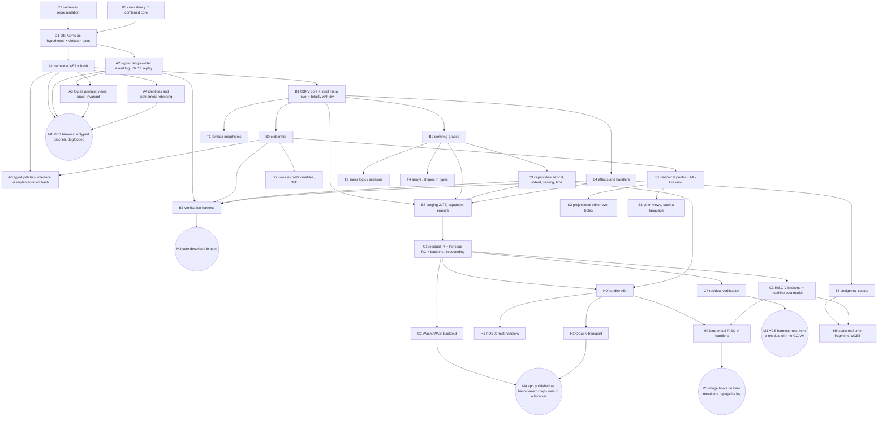

# 02.04.04 2026-09-27 — The substrate: one core, six choices

The substrate is the part of FPL below the notation: the store, the log, the typed core, the
effect discipline and the staging that everything above it stands on. This page is the merged
design. It began as a platform proposal reviewed adversarially by three models (draft 4; the
working name used for outside readers was "Weft", which is FPL), then met the surface syntax
([syntax rationale](02.04.05-syntax-rationale.md)) and absorbed what the combination decided.
Where the merge supersedes draft 4 the text below says the merged thing and does not repeat the
old one.

Pages that split a topic out of this one:

- [Principles, holes and privileges](02.04.07-principles-and-privileges.md): the five standing principles and the loosening machinery.
- [Capabilities, effects and failure](02.04.08-capabilities-effects-failure.md): C3 in detail, the condition system, authority graph.
- [Objects, dispatch and visibility](02.04.09-objects-dispatch-visibility.md): OOP without classes, multimethods, advice.
- [History, store and distribution](02.04.10-history-store-distribution.md): C1 and C6 in detail, identifiers, the log as medium.
- [Contracts, cost and totality](02.04.11-contracts-cost-totality.md): the verification rungs as one predicate.
- [Compiler, backends and assurance](02.04.12-compiler-backends-assurance.md): nanopass pipeline, bootstrap, assembly-level assurance.
- [Numbers, ML and the library](02.04.13-numbers-ml-library.md): representations, algebras, the tensor stack, the standard library.
- [Concurrency, logic and search](02.04.14-concurrency-logic-search.md): the parallelism map, scheduling, spaces.
- [The meta level and the plane](02.04.15-meta-level-and-plane.md): staging, macros, rewriting, 2LTT, the rhizome.

The reference side of the same material lives in [spec](../02.03-reference/spec.md),
[grammar](../02.03-reference/02.03.02-grammar.md), [FON](../02.03-reference/02.03.03-fon.md),
[FML](../02.03-reference/02.03.04-fml.md) and [SHAR](../02.03-reference/02.03.05-shar.md); the
user-facing side in [UI](02.04.06-ui.md). The open items are tracked in
[substrate liabilities](../02.05-project/notes/02.05.11-substrate-liabilities.md), the working
space in [scratchpad design notes](../02.05-project/notes/02.05.09-scratchpad-design-notes.md) and
[discussion design notes](../02.05-project/notes/02.05.10-discussion-design-notes.md).

related:: [Syntax rationale](02.04.05-syntax-rationale.md)
related:: [The vision](design.md)

## 1 Thesis

No single theory of computation is fundamental. The lambda calculus is canonical for functional
composition (the internal language of cartesian closed categories) but is provably not a theory of
interaction, cost or physical computation; linear logic and process calculi are canonical for
other things and disagree with lambda about what counts as equality. A universal language
therefore cannot be one semantics. It can be a **platform**: one notation, one store, one small
core, and theories of computation as *libraries* with explicit, typed morphisms whose kind is
stated (section 5). Racket's `#lang` is the precedent for front-end languages elaborating into a
shared core; it is not a precedent for hosting incompatible definitional equalities, which is a
separate problem (C2, "universes").

Content-addressed intensional identity, capability-mediated effects and explicit staging remove
three sources of accidental coupling that have kept well-understood techniques from coexisting.
The claim is *not* that everything else is then a library. The research programme is to determine
which theories of computation can become libraries over such a core *while keeping their own
equalities*, and to prove it seam by seam; that proof is the hard part.

Three groups who do not share tools should be able to use it: formal-methods people (dependent
types, proofs, category theory), live-programming people (liveness, notation as a tool for
thought), and performance-aware systems programmers (no hidden allocation, inspectable machine
output, raw pointers when wanted).

## 2 Goals

- G1. Each supported theory of computation has a stated kind of embedding with stated preserved properties (section 5).
- G2. Category-theoretic structure is library code that typechecks; gluing theories is a theorem, not an adapter ([the plane](02.04.15-meta-level-and-plane.md)).
- G3. Code is identified by content; definitions also have identity independent of content; names are petnames (C1).
- G4. Live: an image with projectional editing over programs with holes; several surface languages over the same core forms ([UI](02.04.06-ui.md)).
- G5. Acceptable to the performance crowd: no general-purpose runtime unless asked for, deterministic allocation and reclamation, inspectable and diffable machine output, no silent promotion of a static check to a dynamic one, raw memory and jumps when wanted.
- G6. Optional distribution: object capabilities over replicated single-writer logs; no consensus protocol, no tokens; coordination only where invariants are not merge-invariant ([distribution](02.04.10-history-store-distribution.md)).
- G7. Small and bootstrappable: a trusted base with an explicit inclusion list (section 8), every other component removable, a build chain traceable to a seed one person can read.

## 3 The six choices

Each is a current hypothesis with a violation test, revisable only by the research nodes of the
work graph (section 11). The principles that rank above them are in
[principles](02.04.07-principles-and-privileges.md).

| # | Choice | What it fixes | What it explicitly does not claim |
| --- | --- | --- | --- |
| C1 | Three identities for terms (stored: hash modulo alpha; optimisation: e-graph over a declared theory; behavioural: a proven relation), three reference kinds between definitions (by hash, by stable identity, by petname), interface hash beside implementation hash, typed patches, log as single source of truth with store and index as rebuildable views | Content addressing without the cascade problem; hot loading as rebinding; merge conflicts as typed holes | Which nameless representation (de Bruijn, co-de-Bruijn, slots) serves both hashing and e-graph sharing |
| C2 | Polarised call-by-push-value, semiring grades (erasure, linearity, uniqueness, information flow, cost, residency, transient/stable), modules as dependent records, strict meta level (2LTT) over object theories held as universes with logical modularity, totality by default with `div` as an effect, holes as exposed metavariables, an elaborator as a named component | One core for call-by-value and call-by-name; proofs erase; several definitional equalities coexist without pretending to be libraries | Consistency of the whole combination (R3); Hazel-grade live semantics from metavariables alone |
| C3 | Effects are capabilities passed lexically (never dispatched to the nearest handler), with a typed extent (lexical, protocol or clock; clock only over immortal referents); escape is a type error, promotion explicit; capabilities sealed against reflection across stages | Authority without an ambient dictionary; borrowing as lexical extent; confidentiality as a lattice grade, integrity as its own modality | Confinement and noninterference theorems for the combination (R9); extent ergonomics |
| C4 | Explicit sharing, sequential deterministic core, sequentially consistent source semantics; concurrency as handlers with stated operational and fairness contracts; each backend owes a refinement to its target memory model | Step counts as a cost model; data-race freedom by uniqueness grades | That weak memory disappears from the system (it moves to the backend) |
| C5 | Staging first-class with phase separation; the residual is first-order, monomorphic, allocation-explicit, content-addressed, carries source positions; reflection only at the meta level and only as a capability; alpha-safe substitution free, macro hygiene localised in the expander | Live symbolic computation and flat fast code from one source | That hygiene is free |
| C6 | Append-only signed single-writer logs; every external effect and every nondeterministic handler choice is an event; confluent parallel fragments log results; owner chains for non-merge-invariant state | Deterministic replay, time-travel debugging, provenance, a rewindable and forkable image | That multiple feeds form one global history without coordination |

What the substrate left open for the syntax, and how the merge answered it: polarity is decided by
saturation (the old "call-by-value by default, laziness surfaces a thunk" is struck), grades are
written nowhere (they are `dup`, `over` and `drop`), capabilities are reached by path, and a hole is
`_`. See [syntax rationale](02.04.05-syntax-rationale.md).

### C1 Identity, references, patches

- **Identity of terms.** (1) *Stored*: content-addressed abstract binding trees, nameless, hashed modulo alpha only; structural equality decidable, so the term type is a set; float literals hash by bit pattern; hash equality is collision-resistant, not injective, and structural comparison disambiguates on an actual collision. (2) *Optimisation*: e-graphs over a *declared* equational theory with first-class binders (slotted e-graphs). (3) *Behavioural*: a proven relation (bisimulation, logical relations) on the dependent tier. The store never stores modulo beta. E-class membership is a claim that the declared equations justify equality, so a certified bridge from optimisation equality to contextual refinement is required (claim 11); the declared theory's axioms are bisimulations ([rewriting](02.04.15-meta-level-and-plane.md)). Storage and e-graph representations need not coincide if a translation has a proved round trip.
- **Kinds of reference.** An edge from A to B is **by hash** ("exactly this content"; cascades on change; the lockfile), **by identity** ("this definition whatever it is now"; no cascade; Erlang's fully-qualified call), or **by petname** (a signed local binding of a string to an identity; the human layer). Hot loading is rebinding of identities and petnames, never replacement of hashes; whoever holds a hash keeps the old version (Erlang's two-version rule). The syntax gave these criteria: a quotation literal refers by content, a path mention by petname resolved through identity, a hash literal by hash. Sigils and the self-describing identifier format are in [history and store](02.04.10-history-store-distribution.md).
- **Interface vs implementation hash.** The interface hash is the hash of the head line (stack effect, capability requirements, contracts, the set of clause signatures); the implementation hash covers the body. A change that keeps the interface hash transports dependents mechanically; a change to the interface is a real cascade and appears as `_` holes at every dependent. Semver is a computed view of interface-directory diffs.
- **Patches.** A change is a first-class, content-addressed patch between terms; patches are token-array diffs and the dictionary directory holds them (`mean/history`). Over intrinsically typed syntax a patch cannot produce an ill-typed term; a merge of two patches that would be ill-typed yields a non-empty hole containing both alternatives, so the log converges and stays well-typed, and the coordination that non-merge-invariant invariants require (I-confluence) is one human action: filling the hole.
- **Store discipline.** The event log (C6) is the single source of truth; the content store and e-graph index are views rebuildable by replay. Crash consistency reduces to log durability. A semantic-search index is a fourth, never authoritative, view ([history](02.04.10-history-store-distribution.md)).
- Ancestors: Venti, Unison, Salsa/rust-analyzer.

### C2 Core, grades, universes

- Values and computations are distinct sorts; call-by-value and call-by-name are two translations of lambda types (`cbv (A→B) = U(A → F B)`, `cbn (A→B) = U A → B`). The merged design has no default polarity: the surface decides polarity by saturation.
- Grades are parametric in a semiring: `{0,1,ω}` for erasure, linearity and unrestricted use; uniqueness as a separate grade for alias exclusion (linearity constrains use and says nothing about aliasing); a security lattice for information-flow labels with integrity as a distinct modality and a declassification and endorsement policy still to be designed. The merge added a cost semiring (cost is a grade; [contracts and cost](02.04.11-contracts-cost-totality.md)), a residency lattice (`Text@ram`; [history and store](02.04.10-history-store-distribution.md)) and a transient/stable grade for speculation ([assurance](02.04.12-compiler-backends-assurance.md)).
- Modules are dependent records; generativity, abstract types and sealing are encoded. Directories are their surface.
- **Two levels (2LTT).** The meta level is a strict, decidable type theory with UIP and proof irrelevance, so designated evidence erases. Object-level theories with different definitional equalities (observational, cubical, intensional with K) are **universes with logical modularity** (the Multiverse), not `#lang`s; `#lang` is reserved for front ends with a proven elaboration. Each universe ships a fixed list of consequences (which equalities, whether transport computes, whether proofs erase, typechecking cost). The outer level is "the plane"; morphisms between universes are first-class judgments with loss lists ([the plane](02.04.15-meta-level-and-plane.md)).
- Totality is the default as a five-rung ladder (structural, Walther, measure, fuel, `+div`); possible non-termination is an effect, long-running processes are codata ([contracts and totality](02.04.11-contracts-cost-totality.md)).
- Holes: an elaborator metavariable exposed to the user (`_`), with normalisation by evaluation on open terms as the first prototype of live evaluation. Hazel's full machinery is work, not a consequence.
- The **elaborator** is a component in its own right: dependent constraint solving, grade inference (AARA as inference mode), capture and extent checking, implicit polarisation, dependency recording keyed by identity so that re-elaboration after an edit is local ([elaborate pass](../../01-bootstrap/01.02-pass/01.02.06-elaborate.md)).

### C3 Capabilities (summary)

An effect is a capability value that must be held to be invoked (Effekt; capture checking).
Dispatch is to the capability's own handler, never to the nearest enclosing one. Allocation,
reflection, raw memory, references, network, randomness, time and external oracles (including
language models) are capabilities; confidentiality is a lattice grade.

- **Extent.** *Lexical*: a borrow, statically checked; the static rules are a borrow checker inside the type checker. *Protocol*: a session, valid between steps of a declared protocol. *Clock*: valid until a wall-clock or logical-clock event, decided against the log, and permitted **only over immortal referents** (store and log objects). A lexical or protocol right over a mortal referent that would escape is a type error; the programmer resolves it by ownership transfer, promotion into the store, copying, or a revocable handle. Nothing is promoted silently. A right used after its extent is an event in the log but not in effect.
- **Sealing.** Capabilities are sealed values (Morris 1973): opaque, no destructor at the meta level, preserved by staging, so reflection sees a program's shape but never a capability's contents; unsealing needs the unsealer, itself a capability, and is logged. On a CHERI-style target hardware tags enforce it.
- Lineage: Hydra, CAP, KeyKOS/EROS. The confinement proof of EROS holds relative to a capability-machine model; this design owes an analogous one (R9). Secrets follow Plan 9's factotum.

Everything else about capabilities (the two computation effects, `in` and `out`, failure and
supervision, the authority graph, the keyring) is in
[capabilities, effects and failure](02.04.08-capabilities-effects-failure.md).

related:: [Capabilities, effects and failure](02.04.08-capabilities-effects-failure.md)

### C4 Sharing and concurrency (summary)

No implicit graph reduction; sharing is a term-level construct, so step counts are a reasonable
cost model. Concurrency is not primitive: nondeterminism, actors, channels and async are effect
handlers, each with its own operational and fairness contract, and the scheduler handler is part
of the trusted base. Deterministic parallelism lives in the pure fragment. Data-race freedom for
ordinary code follows from uniqueness plus capability discipline. The source semantics is
sequentially consistent and each backend owes a refinement proof to its target's memory model;
weak memory is removed from the source language, not from the system. The machine tier exposes
atomics with explicit orderings, and raw pointers, inline assembly and FFI sit on that boundary.
The three classes of concurrency and the scheduling model are in
[concurrency, logic and search](02.04.14-concurrency-logic-search.md).

### C5 Staging (summary)

Meta-level code is symbolic and live; the residual is first-order, monomorphic,
allocation-explicit, with join points and unboxed data, carries source positions, and is itself a
content-addressed ABT. Reflection exists only at the meta level and only as a capability.
Alpha-safe substitution is free because binders are nameless; macro hygiene is localised in the
expander and is real work. IBM i's TIMI is the precedent for a stable IR surviving hardware
generations. See [meta level](02.04.15-meta-level-and-plane.md), and the
[lower](../../01-bootstrap/01.02-pass/01.02.07-lower.md),
[normalize](../../01-bootstrap/01.02-pass/01.02.08-normalize.md),
[optimize](../../01-bootstrap/01.02-pass/01.02.09-optimize.md) and
[codegen](../../01-bootstrap/01.02-pass/01.02.11-codegen.md) passes that implement the lower half.

### C6 The log

State is a function of an append-only, signed, single-writer-per-identity log (Secure Scuttlebutt,
Hypercore). Every effectful interaction with the outside (I/O, oracle calls, randomness, clock
reads) *and every nondeterministic choice a handler makes* is logged, as record/replay systems do;
confluent pure parallel reductions log only results. Replay is then deterministic (claim 13).
Multiple feeds do not form one global history; where an operation is not merge-invariant there is
a single authoritative owner chain, and that is the only coordination. Whole-image checkpointing
is EROS/KeyKOS orthogonal persistence; the whole machine as a function of its log is Urbit's
solid-state interpreter. Stored identity (C1) is identity of results; the log is identity of
edits; the log is primary. The log is also a temporal database, and an image is rewindable and
forkable ([history](02.04.10-history-store-distribution.md)).

## 4 Architecture

```
surfaces        per-language views (ML-like default | Lisp | concatenative | array) over shared core forms; projectional; holes allowed
names           petnames -> definition identities -> hashes; refactoring and hot rebinding live here
theories        lambda, LL/sessions, games, INets, coalgebra, arrays, autodiff, probability, Datalog, synchronous dataflow ... as libraries with stated seam kinds
universes       object type theories with logical modularity (observational default for programs; cubical for univalent mathematics)
meta / staging  typed macros = functions at level 1; expander; symbolic rewriting on quoted terms; e-graph optimisation with a certified bridge
elaborator      dependent constraints, grades, extents, implicit polarisation, identity-keyed dependency recording
core            polarised CBPV + semiring grades + sealed capabilities with extent; total by default (div as effect)
residual        first-order ABT, explicit allocation, join points, unboxed data; content-addressed; source positions carried through
backends        each owing a memory-model refinement
store           log (primary) -> content store, e-graph index, semantic index (views); memoisation keyed by identity, validated by hash
distribution    object capabilities over replicated single-writer logs; owner chains for non-merge-invariant state (optional)
machine tier    raw memory as a linear capability, atomics with orderings, inline asm, C ABI
bootstrap       reproducible builds; diverse double-compiling; a hand-readable seed; the build graph a Merkle DAG in the store
```

The event log gives time-travel debugging and provenance without a separate tracing system. The
bootstrap pipeline in the repository is the executable counterpart of the upper rows: see the
[boundary](../../01-bootstrap/01.01-boundary/01.01.01-source.md),
[pass](../../01-bootstrap/01.02-pass/01.02.01-lex.md) and
[representation](../../01-bootstrap/01.03-repr/01.03.01-source.md) pages.

## 5 Seams

### 5.1 How each domain is stitched

| seam kind | meaning | must prove | domains |
| --- | --- | --- | --- |
| functor both ways | lossless | typing preservation, equality preservation, operational adequacy, retraction | lambda (cbv and cbn via Levy), combinatory logic |
| embedding one way | a fragment; guarantees hold inside the library | typing preservation, adequacy for the fragment | linear logic and session types (grades + channel effect), coalgebra and streams (codata), arrays (shapes in types), synchronous dataflow (clocks as guarded types), Datalog, modules, machine integers |
| backend | a compilation morphism, possibly partial | refinement to the target's semantics including memory model; stated partiality | section 6 |
| semantic model | the core is an instance of it | soundness of the interpretation | game semantics, CCCs, Freyd categories, the Giry monad, reals with rounding |
| effect encoding | handled; the core's equality does not validate the domain's equality | the handler's operational and fairness contract | pi with choice, actors, logic programming, symbolic rewriting, autodiff, probabilistic programming, external oracles, call-by-reference |
| foreign, behind a capability boundary | native equality differs from the core's | nothing beyond the capability set granted | process bisimilarity as a theory, quantum unitarity, C libraries via FFI |

Between languages the obligation is *adequacy* or *full abstraction*, not equality: an
adequate-only translation may be used to run, not to reason, and a composite inherits the weakest
seam on its path ([compiler](02.04.12-compiler-backends-assurance.md)). A seam is a
typed functor `logic -- core` ([syntax rationale](02.04.05-syntax-rationale.md)), a planted tree
a mounted directory with the reserved entry `seam`. Incremental compilation comes with the
store: queries keyed by definition identity and validated by hash re-elaborate only the affected
definitions (claim 12).

### 5.2 Numbers

Machine types are *representations* of mathematical objects with an explicit relation. `i64` is
either the ring Z/2^64 (wrapping; Z → Z/2^64 is a ring homomorphism) or the refinement
`{x : Z | -2^63 <= x < 2^63}` with partial operations. Floats admit no homomorphism (not
associative); `f64` is the reals plus a rounding function with bounded error (Flocq), the
rounding mode an effect. IEEE 754 is the hardware default, not the semantics. The full
representation lattice, `Money`, angles and algebras are in
[numbers, ML and the library](02.04.13-numbers-ml-library.md).

## 6 Backends and what each cannot honour

Every backend is a compilation morphism from the residual whose partiality is part of its type:
the compiler refuses with a reason rather than failing silently. The order after review is
walker, cbpv-ir, machine IR, WebAssembly, RISC-V, with Perceus-C postponed
([compiler and backends](02.04.12-compiler-backends-assurance.md); the working plan is the
[backend plan](../02.05-project/notes/02.05.12-backend-plan.md)).

| backend | good at | cannot honour |
| --- | --- | --- |
| WebAssembly (integer-only subset, own reference counting in linear memory) | formal spec and validator; deterministic subset; imports as capabilities; `return_call` for `recur/tail` | raw memory outside the sandbox; GC types and exceptions are excluded from the subset |
| RISC-V directly | own codegen; the systems-programmer requirement; the target for WCET | heavy optimisation (hand-written) |
| C with precise reference counting (Perceus-style) to clang/gcc | deterministic allocation and reclamation; a differential-testing route | (postponed, not dropped) |
| LLVM IR directly | the same without C in between | |
| Graal/Truffle (JVM) | a JIT for the live tier (first Futamura projection) | raw memory; GC cannot be switched off |
| interaction nets (HVM-style) | parallelism; work/depth for free | anything outside the dup-free fragment |
| Nock | cheapest backend to write; tests the combinator seam | speed; proof of concept only |
| hardware synthesis from the residual | first-order monomorphic residual is synthesisable (FPL as an HDL) | unbounded recursion, dynamic allocation, timing closure |

## 7 Claims, tensions, exclusions

### 7.1 Claims (attack these)

1. **Alpha-safe substitution is free; hygiene is not.** Nameless binders make capture-avoiding substitution trivial in the core; macro hygiene is real work in the expander.
2. **Ownership is a grade, a uniqueness grade, and an extent.** In a concatenative core the grade rule is three sites: `dup`/`over` need grade ω or a copyable type, `drop` needs an affine grade, `dup` of a unique value is a type error. Extents give a borrow checker with no lifetime inference.
3. **Authority, confidentiality and integrity are three mechanisms in one core.** Lexically passed capabilities, lattice grades, an integrity modality; sealing makes all three survive reflection and staging. Confinement and noninterference theorems are owed (R3, R9).
4. **Designated proof-irrelevant evidence is erased**, and residualisation must be proved insensitive to it (part of R3). Object-level cubical equality has computational content and is not covered.
5. **Jets are translation validation with a stated relation.** A known hash may be replaced by native code only with a proof of contextual refinement including logged effects, allocation and divergence, against the residual; the proof stops at the residual unless the backend is verified.
6. **Negative resource and effect bounds are compositional and cheap; relational and qualitative properties are not.** "Does not allocate / reflect / diverge" follow from absent capabilities and `div`; "does not leak" is relational; cache friendliness is neither.
7. **Cost is checkable and often inferable**: upper and lower, polynomial, inferred; exact by dependent grades ([cost](02.04.11-contracts-cost-totality.md)).
8. **Concurrency need not be in the trusted sequential core;** each handler supplies its own contract and names the confluence theorem it keeps.
9. **The trusted base has an explicit inclusion list with a size target per component;** the Merkle build DAG proves provenance, not correctness of each step.
10. **Syntax is a view per language over shared core forms.** Laws: `parse . print = id` on terms, `print . parse = canonicalize` on source.
11. **The three identities do not collapse, and the middle one carries an obligation.**
12. **Incremental compilation and definition-level caching fall out of content addressing plus identity.**
13. **Replay is deterministic given that every nondeterministic choice is logged.**
14. **Modules need no second surface language;** old data stays readable only while its decoders are retained.
15. **Object theories with different definitional equalities are universes, not libraries.**
16. **Holes as exposed metavariables are a first prototype of live evaluation, not Hazel.**
17. *Withdrawn.* Consistency of the combined core is conjecture R3.
18. **Typed patches make ill-typed results unrepresentable and turn conflicts into typed holes.**

### 7.2 Tensions

| tension | status | how |
| --- | --- | --- |
| reflective towers / fexprs vs static types | mitigated | reflection is a meta-level capability; sealing survives stages; one notation `[ ]` with two types classified by consumer ([syntax rationale](02.04.05-syntax-rationale.md)) |
| live symbolic computation vs data-oriented performance | relocated | staging is the architecture; binding-time analysis, code size, source mapping and residual predictability are the new work |
| distributed world computer vs the systems crowd | resolved socially, bounded technically | optional capabilities; shared history, not shared memory ([distribution](02.04.10-history-store-distribution.md)) |
| many syntaxes vs one community | not resolved | canonical print solves identity; views are per language; idioms remain notation-dependent |
| correctness by construction vs cost of proofs | runtime half resolved | erasure; the verified/unverified boundary is gradual with blame |
| authority vs confidentiality | separated, incompletely | declassification policy owed |
| identity of results vs identity of edits | resolved | both kept; the log is primary |
| univalence vs decidable, erasable programming | separated, not interoperated | 2LTT; cross-universe morphisms are R8 |
| static borrowing vs dynamic rights | resolved as design, ergonomics open | clock extents only over immortal referents |
| nondeterministic parallelism vs deterministic replay | resolved | confluent fragments log results; every handler choice is an event |
| no weak memory in the source vs efficient multicore | relocated | each backend owes a refinement; the machine tier exposes atomics |

### 7.3 Explicitly excluded

Unstratified reflection; behavioural identity as storage; concurrency as a core primitive;
automatic optimal sharing; ambient authority; a weak memory model in the source language; silent
promotion of static checks to dynamic ones; clock-extent rights over mortal referents; continuous
time in the core ([principles](02.04.07-principles-and-privileges.md), P3); cost constants at the
type level; call-by-need as a default; comments and formatting as part of identity; a canonical
concurrency model; proof of cache behaviour; univalence at the meta level; consensus.

## 8 Trusted base and the verification ladder

*Trusted computing base, inclusion list:* the meta-level type checker (conversion, NbE), the
elaborator's constraint and grade solver, the extent checker, the sealing primitive, the expander's
scope discipline, the log's signing and replay, the store's hashing, the scheduler handler and
every other root handler, each backend's codegen (until verified), the FFI boundary, and the
hardware. Size targets are per component, not one number.

*Verification ladder*, over the same definitions: (1) dependent types and proofs; (2)
property-based tests and fuzzing on the residual, replayable from the log; (3) abstract
interpretation, model checking and run-time contracts with blame; (4) inspection of the residual.
Each artefact says which rung it is on. A contract is rung 3 of one predicate whose rung 1 is its
proof ([contracts](02.04.11-contracts-cost-totality.md)).

*The verified/unverified boundary is gradual.* When a verified definition requires evidence an
unverified caller cannot supply, the obligation crosses the boundary as a dynamic check with
blame or as an explicit `assume` recorded in the log as a trust decision. Compositional
correctness holds inside the verified region and the cost of leaving it is visible. This is the
machinery behind the hole discipline ([principles](02.04.07-principles-and-privileges.md), P2).

## 9 Admitted open

- **R3. Consistency of the combined core.** Grades, capability-effects with extents, sealing, 2LTT staging, handlers and open terms together, with erasure and residualisation noninterference. The dependent kernel's bootstrap and the Fire Triangle are in [compiler and bootstrap](02.04.12-compiler-backends-assurance.md).
- **R8. Cross-universe morphisms** ([plane](02.04.15-meta-level-and-plane.md)).
- **R9. Confinement and noninterference** for extents, clock rights and sealing under staging; the statement owed is that the static authority graph bounds every possible log.
- **Rewriting under effects in the e-graph:** narrowed to a local rule (rewriting is valid where no capability is in scope or applied).
- **Which nameless representation** serves storage; **diffing over dependent syntax** (a patch must carry conversion evidence); **extent ergonomics**; **type migration** (ornaments); **side channels** (partly covered by cost grades and leakage contracts, see [assurance](02.04.12-compiler-backends-assurance.md)); **effect inference ergonomics**; **views and types**; the **interaction-net backend** may cover too small a fragment; **FFI is a hole in the trusted base**; **probabilistic and differentiable programs** run first-class but their equational theories are library theorems; **bootstrap is a regress** pushed to a readable seed and agreement between independent compilers; **real-time** outside the allocation-free fragment, verified numerics, Unicode and parsing.
- **Kay's test** (a child can use it) is not met; Engelbart's (augments a skilled user) is the one aimed at.

Expected objections: *scope* ("five theses and a company"; the work graph gives the order and the
first milestone is a version-control harness the project itself uses), *why not compose what
exists* (the three commitments remove coupling; whether the rest follows is the programme), *jets
are a trust problem in disguise* (yes, until the backend is verified), *the hard-real-time subset
is small* (yes; it is the subset in which anyone can do hard real-time).

## 10 Hosting: the kernel is a handler set

A kernel is the set of root capabilities over hardware plus the handlers that implement them;
everything else is a library linked against the program (exokernel and libOS; MirageOS the
existence proof). Bare metal is a backend plus a handler set, provided three constraints hold from
the first line of code:

1. **The core knows no POSIX.** A host OS is a handler set that wraps POSIX; bare metal is another.
2. **The residual links freestanding** (`-nostdlib` is a test on the first backend). "No runtime" means no GC, VM or general-purpose runtime; handlers are runtime support by design.
3. **Time is a capability.** Wall clock, logical clock (HLC), timers and deadlines are issued rights ([principles](02.04.07-principles-and-privileges.md), P3).

Taken from existing systems: BEAM (cheap isolated processes, supervision, hot loading as
rebinding; not its all-or-nothing distribution trust); Plan 9 (per-process namespaces, one wire
protocol; the modern form is OCapN with promise pipelining); Ethereum (replay and metered
execution; not consensus); Urbit (Nock, the solid-state interpreter, jets with proof; not an
untyped core or ambient authority); Singularity/Midori (software-isolated processes, contracts on
channels); Theseus; Hubris and Tock (static task tables, grants as capabilities: the hard
real-time fragment exists); Barrelfish (multikernel); Lisp machines, Oberon, Smalltalk (the image
is the OS); Burroughs B5000, CAP, CHERI (hardware tags; CHERI needs extra machinery for temporal
safety, which is why clock extents are restricted to immortal referents).

Isolation between mutually distrusting images on one machine is not rebuilt: seL4 or Genode
underneath. Secret plus untrusted code belongs in separate images. Real-time: soft real-time
through deterministic allocation and a scheduler handler with a fairness contract; hard real-time
only in the total, first-order, allocation-free fragment where WCET analysis is possible against a
concrete machine model ([concurrency](02.04.14-concurrency-logic-search.md),
[assurance](02.04.12-compiler-backends-assurance.md)). The root handlers are also the root
supervisors, and a bare-metal image restarts as checkpoint plus log replay
([history](02.04.10-history-store-distribution.md)).

### 10.1 Lineage

Every piece has a precedent; the target is the seams. Most of these died of adoption, not of being
wrong; the bet is that the substrate they were each missing is the same one.

| ghost | idea taken | where it lives here |
| --- | --- | --- |
| Xanadu | transclusion is not copying; two-way first-class links | C1 (hash + path), C6 (a link is a logged event) |
| Intentional Programming, MPS | projectional editing over a tree | surfaces ([UI](02.04.06-ui.md)) |
| Lamdu, Hazel | structure editing that cannot produce ill-formed programs; holes with meaning | C1 patches, C2 holes, claim 18 |
| Sketchpad | constraints and direct manipulation | constraint solving as an effect; liveness |
| Interlisp-D, DWIM | structure editing, partial programs | holes |
| Cedar/Mesa | modules with interfaces as contracts | modules as dependent records; interface hashes |
| Oz/Mozart (CTM) | one kernel language, each paradigm an extension | section 5; [concurrency](02.04.14-concurrency-logic-search.md) |
| Miranda, SML, Haskell | one semantics standardised for a domain | what this is not |
| Lisp 1.5 `eval` | the self-describing half page | staging as the typed successor |
| Smalltalk, Self, Lisp machines, Oberon | the image is the system | section 4, section 10 |
| Boxer, Logo, HyperCard | computational medium for non-programmers | Kay's test, section 9 |
| Connection Machine, \*Lisp | data parallelism as the default | interaction-net and GPU backends |
| Transputer, occam | processes and channels in hardware | pi and session libraries; Barrelfish |
| Fifth Generation project | logic programming as infrastructure | the Datalog row; spaces |
| Jini | leases: rights that expire unless renewed | clock-extent capabilities |
| Erlang/OTP | cheap processes, supervision, the two-version rule | section 10, C1 reference kinds |
| OpenDoc, CyberDog | compound documents of components | transclusion at the UI level |
| Hydra, CAP, KeyKOS, EROS | capability OSes; confinement proven under stated conditions | C3, section 10 |
| Burroughs B5000 | types enforced by hardware tags | sealing, CHERI target |
| Multics, IBM i | single-level store; a stable IR above hardware | [history](02.04.10-history-store-distribution.md); C5 residual |
| Plan 9, Inferno, Venti | per-process namespaces; VM as OS; content-addressed storage | C1, section 10 |
| Singularity/Midori, Theseus | language-level isolation carries an OS | section 10 |
| Urbit | Nock, the solid-state interpreter, jets | section 6, C6, claim 5 |
| E, Waterken | object capabilities; a URL as a bearer capability; write-ahead for effects | C3, [history](02.04.10-history-store-distribution.md) |
| Secure Scuttlebutt, Hypercore | signed per-identity logs replicated by gossip | C6 |
| Unison | content-addressed code; a codebase manager | C1 |
| Salsa / rust-analyzer | identity-keyed queries validated by fingerprints | C1, claim 12 |
| Racket | `#lang`: front-end languages elaborating to one core | section 1 |
| Zig, Jai | compile-time execution as the bridge between live and flat | C5; [compiler speed](02.04.12-compiler-backends-assurance.md) |
| STEPS | a whole system in 20k lines | G7, per-component |

The later ghosts (Nix, Terraform, Kubernetes, Datomic, Eiffel, Multics residency, Smullyan's
birds, tinygrad, JAX and others) are re-derived on the six choices in the topic pages above. The
rule for re-derivation is in [history](02.04.10-history-store-distribution.md).

## 11 Work graph

A dependency graph of work packages, not a schedule: no durations, no owners. Edges are real
dependencies; each node has a *done-when* that is a test. **D** are the six choices as decision
records stating a current hypothesis and a violation test; research nodes **R** may revise them.



| node | done when |
| --- | --- |
| D1-D6 | six one-page ADRs, each stating the hypothesis, the R nodes that may revise it, and a test that fails when the choice is violated (a grep for POSIX calls in the core; a term whose hash changes under alpha-renaming) |
| A1 | alpha-variants hash equal; structural comparison disambiguates a synthetic collision; decidable equality proven |
| A2 | two replicas with divergent appends converge; replay reproduces state byte for byte; every external effect and handler choice is an event; also `state_hash(frontier)`, a `Checkpoint` record and the two-replay property |
| A3 | a stated crash-consistency invariant holds under a fault-injection campaign |
| A4 | a definition keeps identity across content changes; rebinding a petname hot-loads without touching hashes |
| A5 | a patch over typed syntax cannot yield an ill-typed term; a conflicting merge is a non-empty hole; an interface-preserving change transports dependents without re-checking. Separate upgrade node after M1; parents B0, R6, R10 |
| **M1** | the project's own source lives in the store and log, committed through it, with untyped patches (parents A1-A4; about 71 days instead of 115, an estimate) |
| B1 | cbv and cbn translations of a lambda fragment typecheck; a diverging definition is rejected without `div`; the meta level has UIP |
| B0 | constraints, grades and extents solved; polarisation implicit; an edit re-elaborates only affected definitions; AARA inference; structural and Walther inference; the authority graph published beside the residual; speed budget |
| B2 | grade-0 arguments absent from the residual; a linear value used twice rejected; an aliased unique value rejected; a lattice-graded leak rejected |
| B3 | no effect without a held capability; an outer handler cannot intercept; a lexical-extent escape over a mortal referent is a type error; a clock-extent overrun is a logged non-effect; reflection over a sealed value yields an opaque node |
| B4 | handlers for state, references, `div`, nondeterminism, each logging its choices; no primitive I/O in the core |
| B5 | a program with a hole evaluates to a result stuck on the hole; filling it resumes from the log |
| B6 | the residual is first-order and monomorphic; with and without proof-irrelevant evidence the residual is byte-identical; a hygiene suite passes |
| B7 | prover models of B1-B3 typecheck; the core interpreter is fuzzed by replay |
| **M2a** | FPL's own tokenizer, parser and printer written in FPL, run by the walker; differential agreement with the Python reference on generated programs |
| **M2b** | elaborator and backends in FPL, compiled through the residual; differential agreement at the residual |
| C1 | output links with `-nostdlib`; allocation is identical across runs; every node carries a source position; scoped to the passes from cbpv-ir to the residual; reclamation test (live heap returns to baseline; zero allocations on a unique-array path) |
| C2, C3 | Wasm/WASI in a browser with an explicit capability set; RISC-V from own codegen and a machine cost model; C3 splits into `.s` and own encoder |
| **M3**, **M4**, **M5** | the harness runs from a residual with no GC or VM; an app published as hash + Wasm + capability set runs in a browser; an image boots on bare metal and replays its log |
| S1-S3 | `parse . print = id`, `print . parse = canonicalize`, one canonical print per hash; live results around holes; each view is a language with the same laws; a `profiles/` node after B3, S1, S3 |
| T1-T5 | each library states its seam kind and proves what that kind requires; T3 checks productivity of a server; T4 is the op set kernel plus rank calculus ([numbers](02.04.13-numbers-ml-library.md)) |
| H0-H5 | handler ABI with scheduling budgets; POSIX host; bare-metal; OCapN transport with migration and `fpl://` authentication; seL4/Genode components; WCET bound for an allocation-free program, lifted from assembly |
| R1-R10 | a dated written verdict per question that revises an ADR or is filed under section 9; R8 gains the address `/fpl/formal/plane` |

Reading the graph: M1 comes first because every later artefact is committed through it; D are
hypotheses; the elaborator B0 is on the critical path of almost everything; C7 is where residuals
are verified; theories T are parallel and optional; hosting H hangs off one handler ABI; research
nodes block specific build nodes and nothing else. The reference implementation (the Python
walker, the executable specification) precedes B0, A1 and A2 as node R0, and later work is
differential against it ([compiler and bootstrap](02.04.12-compiler-backends-assurance.md)). The
project-level sequencing is in the [roadmap](../02.05-project/roadmap.md) and the open bootstrap
questions in [HOLES](../../01-bootstrap/HOLES.md).

## Related

related:: [Syntax rationale](02.04.05-syntax-rationale.md)
related:: [Principles, holes and privileges](02.04.07-principles-and-privileges.md)
related:: [Substrate liabilities](../02.05-project/notes/02.05.11-substrate-liabilities.md)
related:: [Backend plan](../02.05-project/notes/02.05.12-backend-plan.md)
related:: [Grammar](../02.03-reference/02.03.02-grammar.md)
related:: [Evaluation judgments](inspiration/02.04.03-judgments.md)
